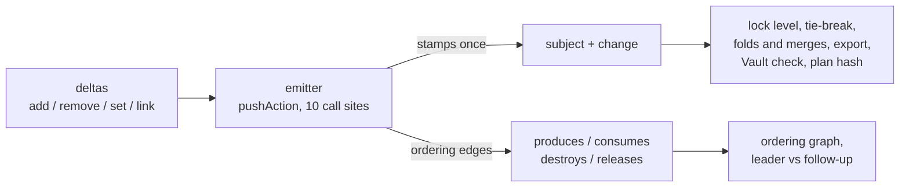

# `Action.subject` and `Action.change` — specification (CLI-3155 / #579)

Status: implemented on `avallete/pg-delta-action-subject`, rebased onto main
`da7aae19`. The numbers below were measured before that rebase, against the base
commit `5cd5279b`. After the rebase the unit suite and the corpus scenarios for
renames, triggers, partitions and columns were re-run on PG 17; CI runs the
rest. Section 7 lists what was not run.

## Summary

- Every plan action now states two things it used to leave to guesswork: the
  fact it is about (`subject`) and, for an `alter`, what about that fact
  changes (`change`).
- The emitter writes both once, at the only place that knows. Nothing
  downstream derives them. Both are part of the plan hash.
- The planner, the export and the Vault check now read these fields. No
  production code reads the first element of `produces` / `consumes` /
  `destroys` any more, and a guard test keeps it that way.
- Plans barely move: of 1,526 corpus plans on
  PG 17, 1,500 are byte-identical to the base, 18 differ only by a corrected
  lock level, 8 run the same statements in a different order, and none has a
  different statement.
- Four questions stay in their own place on purpose (section 4). They are not
  the subject and must not be merged into it.

## 1. The problem

An action had no field saying which object its statement is about. Callers
guessed from the three id lists that order the plan:

```ts
action.produces[0] ?? action.destroys[0] ?? action.consumes[0]
```

Six sites used four variants of that rule. The lists are ordering edges, so
they also carry ids that are only there to sequence the statement. The guess is
wrong whenever one of those comes first:

| Statement | Guessed | Actually about |
|---|---|---|
| `ALTER TABLE t ALTER COLUMN c ADD GENERATED … AS IDENTITY` | the backing sequence | the column |
| `REVOKE ALL ON FUNCTION f FROM anon` (default-privilege cleanup) | the function | the grant to `anon` |
| `REVOKE ALL ON SEQUENCE t_c_seq FROM anon` (same, identity column) | the column | the grant to `anon` |
| `GRANT SELECT ON t TO a, b` (merged) | the table | the grants |

On the PG 17 corpus the guess differed from the truth on 111 of 7,105 actions
(1.6%). The visible consequence was the reported lock level: a cleanup `REVOKE`
took the lock level of the object it was guessed to be about
(`accessExclusive`) when a `REVOKE` takes none.

`verb` does not help. It describes the fact, not the SQL keyword: of the
4,266 `create` actions in the corpus, 2,908 do not
start with `CREATE` (`GRANT`, `REVOKE`, `ALTER TABLE … ADD COLUMN`,
`ADD CONSTRAINT`, `COMMENT ON`). So `alter` + "some table" could be an owner
change, a row-security switch or a cleanup, and a consumer could not tell.

## 2. The model

An action answers six separate questions. Each has one home.

| Question | Home | Written by | Typical reader |
|---|---|---|---|
| Which fact is this statement about? | `subject` | emitter | lock level, tie-break, reviewers, any consumer |
| What about it changes? | `change` (alters only) | emitter | owner fold, cleanup merge, export, reviewers |
| Does this statement bring a fact into existence? | `produces` is non-empty | emitter, compaction | the passes that pair a `REVOKE` with its `GRANT`s |
| What must run before or after it? | `consumes`, `releases`, `destroys` | emitter | the ordering graph |
| Where does it sit among the other statements? | `placementOf()` | derived from `subject` and `change` | tie-break, export in-file order |
| Which export file does it belong in? | `fileSubject()` in the export | derived from `placementOf()` | declarative export only |



## 3. Field specification

### 3.1 `subject: StableId` (required on every action)

**Definition.** The fact this statement creates, changes or drops.

| Rule | Why |
|---|---|
| Fact grain: a column, grant, comment or constraint names itself, not its table. | The fact base is at that grain, and so are deltas. A consumer that wants the table unwraps the id. Going the other way (table to column) is impossible. |
| Stamped by the emitter, never derived. | By the time anything else sees the action the id lists have been merged, tidied and extended with side-effect ids. Section 1 shows the result. |
| It is an identity, not a lookup key. | A drop's subject exists only in the source state. A cleanup's subject (a grant PostgreSQL or the platform created by default) exists in neither. A consumer must not assume `desired.get(subject)` succeeds. |
| It is spelled the way its statement spells it. | After an accepted role rename, every id that embeds the role uses the new name, because the statement runs after the rename. The source state still has the old spelling. Found by the stamp check: `DROP USER MAPPING FOR "r2"` has subject `userMapping:srv.r2`, which the source knows as `srv.r1`. The id lists and `plan.deltas` already follow the same convention. |
| A create's subject is in the state the plan converges to. | That is the desired state plus whatever a policy keeps from the source. Found by the stamp check: a policy that keeps a column grant makes the plan re-create it after a table-level `REVOKE` wipes it, although the desired state does not list it. |
| Every statement of a multi-statement create has the same subject. | `CREATE TABLE` and its `ALTER TABLE … ENABLE ROW LEVEL SECURITY` are one fact arriving in two statements. Which one is first is a different question (section 4.1). |
| A merged statement keeps the subject of its first member. | `GRANT … TO a, b` is one statement for several grant facts. One field can name one fact. See the limit in section 8. |
| The name matches `Diagnostic.subject` and `subjectOf(delta)`. | Both already mean "the fact this is about" in the code base. |

What each of the ten emit sites stamps:

| Site (`action-emitter.ts`) | verb | subject | change |
|---|---|---|---|
| create, every statement of the fact | create | the fact | none |
| rename | alter | the new id | `rename`, `from` = old id |
| rename of a child that kept its name across its parent's rename | alter | the new id | `rename`, `from` = the old name under the parent's new name |
| replace: drop half | drop | the replaced root | none |
| default-privilege cleanup `REVOKE` | alter | the grant `(target, grantee)` | `defaultPrivileges` |
| export wipe of a platform default grant | alter | the default-privilege entry | `defaultPrivileges` |
| drop | drop | the fact | none |
| in-place alter | alter | the fact | `attribute`, `name` = the delta's attribute |
| owner change (from an owner `link` delta) | alter | the object | `owner`, `to` = role name |
| owner re-established after a replace | alter | the object | `owner`, `to` = role name |

### 3.2 `change: ActionChange` (required on an `alter`, forbidden otherwise)

```ts
type ActionChange =
  | { kind: "attribute"; name: string }  // a payload attribute
  | { kind: "owner"; to: string }        // the owner edge
  | { kind: "rename"; from: StableId }   // identity
  | { kind: "defaultPrivileges" };       // cleanup of what was granted by default
```

| Decision | Why |
|---|---|
| One kind per cause, as a tagged value, not a string. | The first spike used a string (`"owner"`, `"name"`, `"privileges"`). `privileges` is also a real payload attribute of a grant (`rules/roles.ts`), so a cleanup and an attribute change could not be told apart, and a typo compiled. With a tag per cause they cannot collide and the compiler checks every reader. |
| The kinds mirror what caused the statement. | `attribute` comes from a `set` delta, `owner` from an owner `link` delta, `rename` from an accepted rename. Cleanup has no delta at all, which is exactly why it needs its own kind. |
| `attribute.name` is the delta's attribute name, unchanged. | `plan.deltas` already publishes those names. Inventing a second vocabulary would create a mapping to maintain. The corpus check asserts each one has a matching `set` delta. |
| `owner.to` is the role name. | The fold that turns `CREATE SCHEMA` + `OWNER TO` into `CREATE SCHEMA … AUTHORIZATION` used to find the role by scanning `consumes` for "the one role id". Now it reads it. |
| `rename.from` carries the id right before the statement. | A rename is the one statement about two identities. `destroys` holds the whole renamed subtree, so the old root was not recoverable by position. For a child that kept its name across its parent's rename, that id is in neither state: PostgreSQL has already moved the child under the parent's new name, and the statement renames it from there. |
| `defaultPrivileges` covers two statements with one meaning. | Both revoke privileges that exist by default and that neither state records as a fact: the object-level `REVOKE ALL` after a create under default privileges, and the export's `ALTER DEFAULT PRIVILEGES … REVOKE ALL` for a grant the load destination sets up on its own. The second used to be emitted as a `create` of a made-up empty fact, which broke "a create's subject is in the target". The stamp check found it. It is now an alter with this change. |
| Absent on create and drop. | Their verb already says everything; there is nothing to qualify. Enforced by the type (section 5). |

Corpus distribution of the 1,159 alters: 586 `owner`, 522 `attribute` (most common: `type` 174, `values` 104, `identity` 32), 47 `defaultPrivileges`, 4 `rename`. Every alter
carries a change; no create or drop does.

### 3.3 Plan file

- Both fields are hashed into `planId`. A plan whose subject or change was
  edited after planning is rejected, like an edited statement.
- `parsePlan` validates the shape: `subject` must be a valid id, an alter must
  carry a well-formed `change`, a create or drop must not carry one.
- `ENGINE_VERSION` moves from `0.3.0` to `0.4.0`. A plan saved by an earlier
  version has neither field and must be re-planned. This is the same mechanism
  as the `0.3.0` bump for `planId`.

## 4. What stays separate, and why

These were candidates for "one field for everything". The spike showed they are
four different questions. Each one below says what would break if it were merged
into `subject`.

### 4.1 Leader versus follow-up: `produces`

A `REVOKE ALL` that opens a grant and the `GRANT` that follows it have the same
subject. Three compaction passes need to tell them apart (the leader may be
elided when the object is created in the same plan; the follow-ups may then
merge). The leader is the statement whose `produces` is non-empty. That is the
definition of `produces`, not a guess, so it stays there.

### 4.2 Ordering anchors: `consumes`, `releases`, `destroys`

A cleanup `REVOKE` on an identity column's backing sequence is about a grant on
the sequence, but it has to wait for the column, because creating the column is
what creates the sequence. "About" and "after" differ, and the old guess mixed
them up. These lists keep carrying ids that are not the subject.

### 4.3 Export file placement: `fileSubject()`

The declarative export loads files one at a time. A sequence owned by a table
column needs its `OWNED BY` and owner statements in the table's file, or the
load order breaks. So the file is "the subject, except a sequence's satellites
follow the owning table". The function is named `fileSubject`, starts
from `placementOf()` (section 4.4) and documents that it answers a different
question.

### 4.4 Placement: `placementOf()`

Where a statement sits among the others is the fourth separate question. It is
the subject, with one declared exception: a default-privilege cleanup is placed
with the object it cleans, not with its own (grant) subject.

```ts
action.change?.kind === "defaultPrivileges" && isAclId(subject)
  ? subject.target
  : subject
```

One function, two readers: the plan's tie-break and the export's in-file
order. Both reasons were measured, not assumed:

- **Plan tie-break.** Sorted as a grant, the cleanup lands between two `GRANT`s
  of the same object, by grantee name. On the first spike run that reordered
  23 of 1,526 plans and split three merged `GRANT`s into two statements each.
- **Export order.** Sorted as a grant, the cleanup lands after the table's
  `OWNER TO` in the grouped layout. Once the table belongs to someone else, a
  loader that is not a member of the new owner can no longer revoke. The
  cross-model review found this; `export-schema-adp.test.ts` now pins it.

With the rule, the cleanup follows its object's create. Eight plans in three
scenarios still change order against the base (section 6). In those the old
guess was not the cleaned object either (it was a column grant the cleanup
wipes, or the identity column), so the old position was an accident.

## 5. How it is enforced

A wrong stamp would be trusted silently, so four layers check it.

| Layer | What it catches | Where |
|---|---|---|
| Types | An alter without a change, or a create/drop with one, does not compile. `pushAction` requires `change` exactly when the verb is `alter`. | `plan.ts` (`Action` is a union on `verb`), `action-emitter.ts` |
| Plan file | The same rules on a parsed plan, plus the hash. | `artifact.ts` (`assertChange`) |
| Guard test | Any production read of `produces[n]` / `consumes[n]` / `destroys[n]`. The kind-sniffing ratchet for `internal.ts` drops from 40 to 34. | `plan/plan.guard.test.ts` |
| Corpus check | Every action of every corpus plan, both directions (below). | `tests/action-stamps.ts`, called from `tests/engine.test.ts` |

The corpus check asserts, per action:

- the statement text mentions every name the subject carries (table and
  column, target and grantee, …);
- create: the subject exists in the desired state, or in the source (a
  policy-kept fact put back after a wipe); a leader produces it;
- drop: the subject exists in the source state (looked up under the old role
  name after a role rename) and is in `destroys`;
- `attribute`: the subject exists in both states and `plan.deltas` has a `set`
  delta for that subject and attribute name;
- `owner`: the desired state's owner edge for the subject points at `to`, and
  the statement names that role;
- `rename`: the subject is not in the source, is in the desired state and is
  produced; `from` is in the source and destroyed, or, for a child renamed after
  its parent, is the old child name under the parent's new name;
- `defaultPrivileges`: the subject is a grant or a default-privilege entry
  that the desired state does not have.

What it found: nothing wrong with any stamp, and four things the
first version of this document had wrong about the model.

| Found on | What | Outcome |
|---|---|---|
| corpus, 9 scenarios | `DROP TYPE "status__pgdelta_replaced"` has subject `type:status`. A rebuilt enum is moved aside under a temporary name. | Stamp is right. The name check allows the temporary name. |
| unit suite | A `create` whose subject is in neither state: the export's wipe of a platform default grant. | Model fixed: it is now an alter with `defaultPrivileges` (section 3.2). |
| unit suite | After a role rename, subjects use the new role name. | Rule added to section 3.1. |
| unit suite | A policy-kept fact is re-created although the desired state does not list it. | Rule added to section 3.1. |

A reviewer probe also showed the name rule is too strict for one statement: an
identity change can address the backing sequence alone (`ALTER SEQUENCE …`),
naming neither the table nor the column. The check allows that form.

`tests/action-subject.test.ts` is the regression test: one plan with an
identity add, a cleanup `REVOKE`, a merged `GRANT`, a rename, an owner change
and a row-security switch, snapshotting verb, subject, change, lock level and
statement. It cannot pass on the base commit, where the fields do not exist.

## 6. Measured results

### Tests

| Check | Result |
|---|---|
| Unit suite (`bun test src/`) | 1,556 pass, 0 fail |
| Typecheck, lint, format | pass |
| Corpus, PG 17 (774 cases, both directions) | 774 pass, 0 fail (base: 774 pass) |
| Corpus, PG 17, rerun after the review fixes | 774 pass, 0 fail |
| Corpus, PG 18 | 774 pass, 0 fail |
| Corpus, PG 14 | 774 pass, 0 fail |
| Integration suite, PG 17 (128 files, everything except the corpus) | 969 pass, 0 fail |
| Supabase-image tests (16 files: extension intents, profile, export) | 78 pass, 0 fail |
| Declarative schemas through the Supabase CLI (smoke set) | 7 of 7 scenarios pass (stack backend, PG 17) |

The integration and Supabase suites were run twice: once before and once after
the two review fixes (section 6, "Review"). On the second integration run
`tests/ssl-operations.test.ts` failed its container health check; it passes
alone (6 of 6), so the count above adds it back.

The PG 17 corpus was run again after the review fixes. The
PG 14 and PG 18 runs started before them. Those fixes touch the export, the
export-only wipe loop and a refactor of the tie-break expression into
`placementOf()` with the same logic; none changes what the corpus executes.

### Plans against the base (PG 17 corpus, 1,526 plans, 7,102 actions)

| Outcome | Plans |
|---|---:|
| Byte-identical | 1,500 |
| Same statements, same order, corrected lock level only | 18 |
| Same statements, different order | 8 |
| Different statements | 0 |

- 25 statements in 22 plans changed lock level, all `REVOKE ALL` cleanups going
  from `accessExclusive` to `none`.
- The 8 reordered plans are 3 scenarios
  (`repartition-key-identity-sequence-hygiene`,
  `column-grant-under-default-privileges`,
  `replace-under-default-privileges-keeps-column-grant`). In each a cleanup
  `REVOKE` moved next to the object it cleans. All still prove.
- No action changed verb in the corpus. The export-only wipe (create to alter)
  does not occur there.

### Stamp check coverage

| Where | Plans | Actions | Wrong stamps |
|---|---:|---:|---:|
| Corpus PG 17 (built into the corpus test) | 1,526 | 7,102 | 0 |
| Integration suite PG 17 (temporary hook on every `plan()` call) | 353 | 7,031 | 0 |
| Supabase-image tests (same hook) | 105 | 892 | 0 |
| Unit suite (same hook) | 287 | 655 | 0 |

The hook runs were made before the two review fixes and the hook was then
removed; only the corpus check is permanent.

### Speed (10 interleaved rounds against the base, one machine)

Verdict of the benchmark harness: no significant regression. Round trips,
connections and bytes received are unchanged.

| Scenario | Base | Spike | Change |
|---|---:|---:|---|
| extract | 296.6 ms | 294.4 ms | −0.7% |
| plan (small delta) | 19.1 ms | 19.3 ms | +0.8% |
| plan (small delta, Supabase profile) | 109.7 ms | 105.2 ms | −4.1% |
| plan (empty → large) | 276.6 ms | 275.6 ms | −0.4% |
| declarative export (Supabase profile) | 751.3 ms | 726.1 ms | −3.4% |
| declarative sync, no-op (Supabase profile) | 2.51 s | 2.51 s | −0.3% |

The first spike run showed +4.2% on the large plan. It does not reproduce.

### Failing-first evidence

Run against the base commit `5cd5279b`:

- `tests/action-subject.test.ts`: fails, `undefined is not an object
  (evaluating 'a.subject.kind')`.
- `plan.guard.test.ts`: fails, listing 13 positional reads in 5 files.
- `artifact.test.ts` (subject and change): fails, a plan without `subject`
  parses.
- The plan-file hash test fails if either field is removed from the hash
  (checked by mutation).
- The two export regression tests pass on the base, failed on the spike before
  the fix, and pass now.

### Review

One cross-model review (Codex, `gpt-6.2-sol`) of the diff. Two significant
findings, both real regressions introduced by this change, both fixed with a
failing-first test:

1. In the grouped export a cleanup `REVOKE` was ordered after the table's
   `OWNER TO`. Fixed by `placementOf()` (section 4.4).
2. An assumed default grant listed twice emitted its wipe twice, because the
   wipe no longer registered as a producer. Fixed by deduplicating the input
   once in `plan()`.

Its smaller points were applied too. Second pass on the fixed diff: one more
ordering point, not fixed and deferred to #563 (item 1 in section 8), and three
smaller points that were applied (`parsePlan` rejects a change carrying another kind's
fields, one shared module walker in the guard test, trimmed comments).

## 7. Not run

- Corpus on PG 15 and PG 16.
- Integration and Supabase-image suites on anything but PG 17.
- The full declarative-schema scenario set and the legacy backend (only the
  smoke set on the stack backend was attempted).
- A third review pass. Two were run; the loop stops there on purpose.

## 8. Limits and decisions for review

1. **Adding identity to a column now runs after the table's `OWNER TO`.
   Deferred to [#563](https://github.com/supabase/pg-toolbelt/issues/563).** It
   used to run before, because it was sorted as the backing sequence; it now
   sorts as the column, like every other column alter. The second review pass
   flagged it: an applier that may set the new owner but cannot act as that
   owner would hand the table over and then fail.

   Measured by applying the plan as a non-superuser, with the identity
   statement in the old place and in the new one (PG 15 and PG 17, same result
   on both):

   | Applier, relative to the new owner role | Identity before `OWNER TO` (old) | Identity after (new) |
   |---|---|---|
   | member that inherits (Supabase's `postgres`) | applies | applies |
   | member that does not inherit (`NOINHERIT`) | fails: the new owner's `REVOKE ALL` → `permission denied for table t` | fails: `ADD GENERATED` → `must be owner of table t` |
   | same, plan also adds a column | fails: `ADD COLUMN` → `must be owner of table t` | fails at the same statement |
   | not a member | fails at `OWNER TO`; `plan()` throws with a capability | same |

   No applier passes with the old order and fails with the new one. The only
   applier that fails after the handover is the `NOINHERIT` member, and it
   already failed one statement later. The capability guard does not catch it
   either: `plan()` succeeds for that applier and the apply fails.

   That is the "NOINHERIT applier" row of the blocker table on
   [#564](https://github.com/supabase/pg-toolbelt/pull/564) (draft, changes
   requested; it replaced #493 and closes #563). Its fix grants the role to the
   applier before the first `OWNER TO` and revokes it after the last statement
   on an object the role ends up owning. It finds those statements by walking
   `produces`, `consumes` and `destroys` up to the owned object, so it covers
   the identity statement wherever it sorts. Nothing to do here.
2. **A merged statement names one fact.** Nine corpus statements are
   a `GRANT` to several grantees; their subject is the first grantee's grant.
   For a merged `REVOKE` and for `CREATE TABLE` with folded columns the other
   facts are still listed in `produces`. For a merged `GRANT` on an object
   created in the same plan they are listed nowhere, because the leading
   `REVOKE` that produced them was elided. A possible fix is to make such a
   `GRANT` the leader (it is the statement that brings the grant into
   existence). It changes `produces` for those statements and was not tried.
3. **Attribute names are internal payload keys** (`def`, `expr`, `reloptions`,
   `values`). They are already public through `plan.deltas`; this makes them
   part of the action contract too. Renaming one becomes a breaking change.
4. **A create follow-up does not say which aspect it sets.** `ALTER TABLE …
   ENABLE ROW LEVEL SECURITY` emitted as part of a create has verb `create`
   and no `change`. Only alters are qualified.
5. **A new emit site can still stamp the wrong subject.** The type forces a
   stamp to exist, and the corpus check catches a wrong one only if a scenario
   reaches that site.
6. **Stored plans must be re-planned** after upgrading (version `0.4.0`).
7. **Two export statements change shape, not text.** The wipe of a platform
   default grant is an `alter` instead of a `create`, and a regular index whose
   name or predicate contains the word `concurrently` is no longer mistaken for
   a concurrent build (the old check was a regex on the SQL). Export output is
   otherwise covered by the export tests and the CLI scenarios in section 6.
8. **The planner did not get smaller.** Production code is +268 / −212 lines in
   10 files. What went away is guessing, not volume: all 13 positional reads,
   nine SQL-text regex checks and one `startsWith` in the planner, the export
   and the Vault check, and a set of rename action indexes that was threaded
   through four files.

## 9. Path to a PR

- Commit 1, tests only: `tests/action-subject.test.ts`, the plan-file test and
  the guard test, failing on the base.
- Commit 2: the change, fixtures, changeset (`minor`), docs.
- Reply on #579: the field exists as `subject`, stamped rather than derived,
  with `change` for alters; the "first id" rule is not what it returns.
